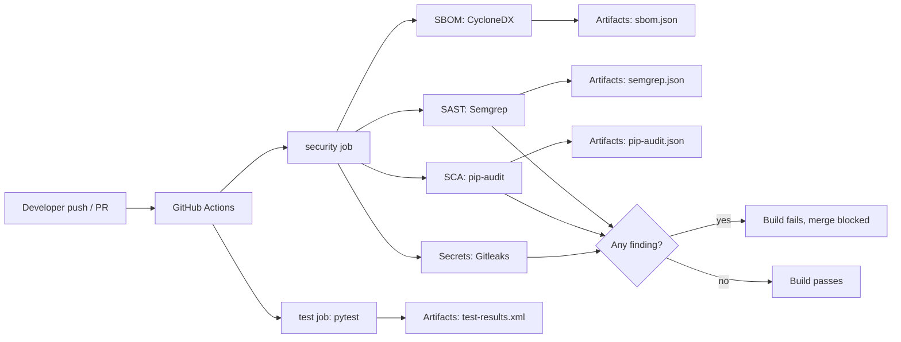

# Technical Report: Automated Security Scanning in a CI Pipeline

**Project:** Secure-CI-Workflow
**Author:** Dhananjay Gupta
**Date:** 14/11/2026
**Repository:** https://github.com/dhananjaygupta1312-arch/Secure-CI-Workflow

> Replace every **[bracketed]** item with your real data from `evidence/before/` and `evidence/after/`. Do not publish numbers you have not measured.

---

## 1. Summary

This project builds a GitHub Actions pipeline that automatically tests a Python Flask application and scans it for security problems on every push and pull request. A deliberately vulnerable version of the app was scanned to establish a baseline, then fixed, and the pipeline was configured to fail the build whenever a scanner reports findings.

**Headline result:** [N] code findings and [N] vulnerable-dependency CVEs on the vulnerable version were reduced to [0] on the fixed version, and a deliberately reintroduced flaw was blocked by the pipeline.

**Key lesson:** passing unit tests did not indicate security. The scanners found issues the tests could not, and the scanners themselves had blind spots (for example, a hardcoded generic password was not detected by the secret scanner).

---

## 2. Objectives and scope

**Objectives**
1. Run automated tests in CI.
2. Add static analysis (SAST), dependency scanning (SCA), secret scanning, and SBOM generation.
3. Produce before and after evidence of vulnerabilities and their fixes.
4. Make the pipeline fail on findings so insecure code cannot merge unnoticed.
5. Document the process so it can be reproduced.

**In scope:** a small Flask app, GitHub Actions, open-source scanners, local reproduction on Linux (WSL2).

**Out of scope:** dynamic testing (DAST), container image scanning, production deployment, runtime monitoring.

---

## 3. Architecture



*(If your viewer does not render Mermaid, draw this as an image in diagrams.net and embed it.)*

**Environment:** GitHub-hosted runner `ubuntu-24.04`, Python 3.12 (3.9 for the vulnerable baseline).

**Two states of the code**
- Tag `v0-vulnerable`: planted flaws and old dependencies.
- Branch `main`: remediated code and upgraded dependencies.

---

## 4. Tool selection

| Purpose | Tool | Why chosen | Limitation |
|---|---|---|---|
| Unit tests | pytest | Standard, simple, JUnit XML output | Tests behavior, not security |
| SAST | Semgrep | Free, fast, readable rules, JSON output | Rule-based; misses logic flaws and can raise false positives |
| SCA | pip-audit | Checks pinned packages against public vulnerability data | Only known CVEs; needs resolvable requirements |
| Secret scanning | Gitleaks | Scans files and full Git history | Matches known patterns; misses generic passwords |
| SBOM | CycloneDX (`cyclonedx-bom`) | Standard machine-readable inventory | Reflects only what the requirements file declares |

Alternatives considered: CodeQL (SAST), Trivy and Dependabot (SCA), Syft (SBOM). [Add your own reasoning for not choosing them.]

---

## 5. Implementation

### 5.1 The vulnerable application

| Flaw | Location | Category |
|---|---|---|
| SQL built with string formatting | `/user` route | Injection (OWASP A03) |
| `yaml.load` on request data | `/config` route | Unsafe deserialization |
| Hardcoded secret in source | `API_KEY` constant | Sensitive data exposure |
| `debug=True` | app entry point | Security misconfiguration |
| Old pinned dependencies | `requirements.txt` | Vulnerable components (OWASP A06) |

### 5.2 The pipeline

Defined in `.github/workflows/Secure-CI.yml`. Two jobs run in parallel:

- **test**: installs dependencies, runs `python -m pytest`, uploads `test-results.xml`.
- **security**: runs SBOM, Semgrep, pip-audit, and Gitleaks, then uploads reports.

Key configuration decisions:
- `runs-on: ubuntu-24.04` is pinned for reproducibility.
- `permissions: contents: read` follows least privilege.
- `fetch-depth: 0` lets Gitleaks scan the whole history.
- `if: always()` on scanner steps so every scanner runs even if an earlier one fails, giving a complete picture.
- **Two modes:** the baseline used `|| true` and `continue-on-error` so all findings could be collected. The enforced mode removes them so findings fail the build, and uses `semgrep --error`.

### 5.3 The fixes

| Flaw | Fix |
|---|---|
| SQL injection | Parameterized query: `execute("... WHERE name = ?", (name,))` |
| Unsafe YAML | `yaml.safe_load` |
| Hardcoded secret | Read from `os.environ.get("API_KEY")`; secret must also be rotated |
| Debug mode | `debug=False` |
| Vulnerable dependencies | Upgraded Flask, Werkzeug, Jinja2, PyYAML, Requests to supported versions |

Changes were made on a branch and merged through a pull request so the pipeline checked them before merge.

---

## 6. Results

### 6.1 Before and after

| Finding | Tool | Severity | Before | After | Fix |
|---|---|---|---|---|---|
| SQL injection | Semgrep | High | Found | Gone | Parameterized query |
| Unsafe `yaml.load` | Semgrep | High | Found | Gone | `safe_load` |
| Debug mode | Semgrep | Medium | Found | Gone | `debug=False` |
| Hardcoded secret | Gitleaks | High | **Not detected** | n/a | Environment variable |
| Vulnerable dependencies | pip-audit | [Varies] | [N] CVEs | [0] | Upgrades |

**Totals:** Semgrep [N] → [0]; pip-audit [N] CVEs → [0]; Gitleaks 0 → 0.

### 6.2 Test results
- Before: [1 passed] (`evidence/before/test-results.xml`)
- After: [1 passed] (`evidence/after/test-results.xml`)

Tests passed in both states, which shows that functional tests do not reveal security flaws.

### 6.3 Dependency inventory (SBOM)
SBOMs are stored in `sbom/sbom-before.json` and `sbom/sbom-after.json`. Summary table (from `pip-licenses`):

| Package | Version before | Version after | License |
|---|---|---|---|
| flask | [2.0.1] | [x.y.z] | [BSD-3] |
| werkzeug | [2.0.3] | [x.y.z] | [BSD-3] |
| jinja2 | [3.0.1] | [x.y.z] | [BSD-3] |
| pyyaml | [5.4.1] | [x.y.z] | [MIT] |
| requests | [2.25.0] | [x.y.z] | [Apache-2.0] |

### 6.4 Gate test
A branch that reintroduced `yaml.load` caused the Semgrep step to fail and the pull request check to turn red. [Insert screenshot.] The branch was then deleted.

### 6.5 Screenshots
- [Actions run on `v0-vulnerable`]
- [Semgrep findings log]
- [pip-audit findings log]
- [Green run on `main`]
- [Failed PR check]

---

## 7. Analysis

### What worked
- Semgrep flagged the injection, deserialization, and debug-mode flaws with clear explanations.
- pip-audit identified known vulnerable versions and the fixed versions to upgrade to.
- Pipeline enforcement turned scanning from a report into a gate.
- The SBOM gives a fast answer to "are we affected?" when a new CVE is published.

### What the tools missed or got wrong
- **Gitleaks did not detect the hardcoded password.** It reported "8 commits scanned, no leaks found". Scanners match known token formats, so a plain string such as a password is easy to miss. A "no findings" result is not proof of safety.
- Logic flaws, broken authorization, and design weaknesses are outside what these rule-based tools detect.
- Semgrep can produce false positives; findings need human review. [Add any you observed.]
- pip-audit only reports **known** CVEs and depends on the quality of the requirements file.

### Secrets in Git history
Removing a secret from the current code does not remove it from history. Gitleaks, scanning the full history, can keep flagging it. The correct response is to **rotate the secret**, since it must be treated as compromised, and then suppress the historic finding with `.gitleaksignore` if appropriate.

### Problems encountered and how they were solved

| Problem | Cause | Resolution |
|---|---|---|
| `setup-python` could not find Python 3.9 | `ubuntu-latest` moved to Ubuntu 26.04 | Pinned `ubuntu-24.04` |
| `ModuleNotFoundError: No module named 'app'` | `pytest.ini` was inside `app/`, so it was ignored | Moved to project root; used `python -m pytest` |
| Push rejected, diverged history | Edited on GitHub and locally | `git pull --rebase`, resolved workflow conflict |
| Detached HEAD | Rebase left unfinished | Finished the rebase and returned to `main` |
| Gitleaks found no secret | Generic string, no known pattern | Documented as a limitation |

### Limitations of this project
- Small, single-purpose app; results may not generalize.
- Python 3.9 baseline is end-of-life, used only for demonstration.
- No DAST, container, or infrastructure scanning.
- Actions are referenced by version tag rather than pinned commit SHA.

---

## 8. Lessons learned

1. Security scanning belongs in CI so problems are caught at review time (shift-left).
2. Passing tests are not evidence of security.
3. Reproducible pipelines need pinned runners and versions.
4. Every scanner has blind spots; use several and review the output.
5. Fix the cause (rotate secrets, upgrade dependencies) rather than only silencing the alert.
6. Small Git mistakes (diverged history, detached HEAD) are recoverable when you stop and read the message.
7. Keeping a journal of exact errors made troubleshooting faster the second time.

---

## 9. Recommendations and next steps

- Enable **Dependabot** for automatic dependency updates and alerts.
- Require status checks via **branch protection** so failing PRs cannot merge.
- Add **Trivy** for container images and **OWASP ZAP** for DAST.
- Fail builds on **high severity** only and track lower ones, to limit alert fatigue.
- Pin GitHub Actions to full commit SHAs and review updates.
- Add custom Semgrep rules and a secret pattern for internal credential formats.
- Publish the SBOM with each release.

---

## 10. References

- GitHub Actions documentation: https://docs.github.com/actions
- Semgrep documentation: https://semgrep.dev/docs
- pip-audit: https://github.com/pypa/pip-audit
- Gitleaks: https://github.com/gitleaks/gitleaks
- CycloneDX: https://cyclonedx.org
- OWASP Top 10: https://owasp.org/www-project-top-ten
- NIST National Vulnerability Database: https://nvd.nist.gov
- Python versions manifest for `setup-python`: https://github.com/actions/python-versions

---

## Appendix A: Reproduction commands

```bash
git clone https://github.com/dhananjaygupta1312-arch/Secure-CI-Workflow.git
cd Secure-CI-Workflow
git checkout v0-vulnerable && ./run_all.sh evidence/demo-before   # expect FAIL
git checkout main && ./run_all.sh evidence/demo-after             # expect PASS
```

## Appendix B: Evidence index

| Item | Path |
|---|---|
| Baseline scan outputs | `evidence/before/` |
| Post-fix scan outputs | `evidence/after/` |
| SBOMs | `sbom/` |
| Workflow | `.github/workflows/Secure-CI.yml` |
| Journal | `journal/learning-journal.md` |
